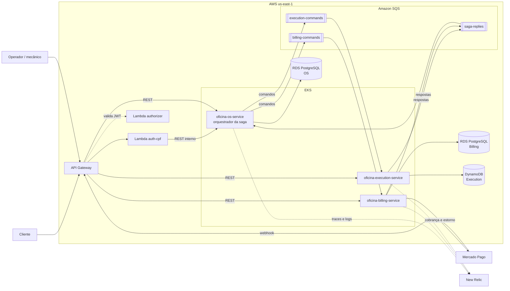
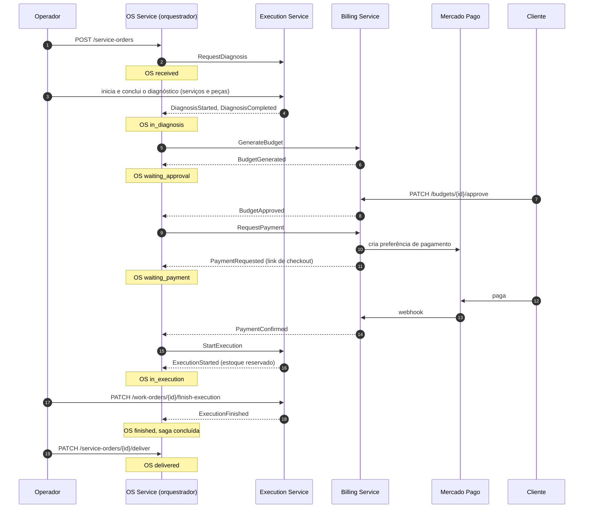
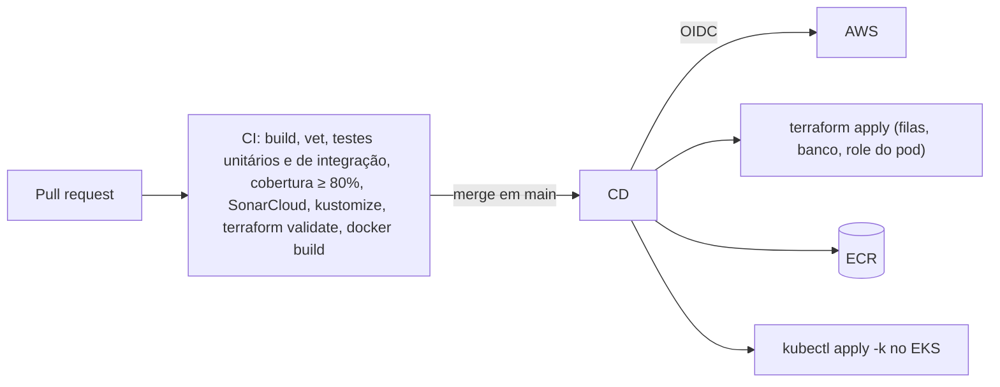

# Tech Challenge — Oficina Mecânica · OS Service

[](https://github.com/gaabriel165/oficina-os-service/actions/workflows/ci.yml)
[](https://sonarcloud.io/summary/new_code?id=gaabriel165_oficina-os-service)
[](https://sonarcloud.io/summary/new_code?id=gaabriel165_oficina-os-service)

Microsserviço de **ordens de serviço** do Sistema Integrado de Atendimento e Execução de Serviços de uma oficina mecânica, desenvolvido para o Tech Challenge da pós-graduação em Arquitetura de Software (FIAP SOAT). Cuida de clientes, veículos e ordens de serviço e é o **orquestrador da saga** que leva uma ordem do diagnóstico à entrega, passando pelos microsserviços de faturamento e de execução.

- **Fase 1** — MVP com DDD, JWT e testes.
- **Fase 2** — Clean Architecture, Kubernetes (EKS), Terraform e CI/CD.
- **Fase 3** — API Gateway, autenticação por CPF em Lambda, observabilidade com New Relic e documentação arquitetural.
- **Fase 4** — o monólito foi dividido em **três microsserviços**, cada um com repositório, banco e pipeline próprios, comunicando-se por REST e por mensageria, com **Saga orquestrada**, pagamento pelo **Mercado Pago**, testes com cobertura mínima de 80%, BDD e análise de qualidade no CI.

## Repositórios do projeto

| Repositório | Papel | Banco |
|---|---|---|
| **[oficina-os-service](https://github.com/gaabriel165/oficina-os-service)** (este) | Ordens de serviço, clientes, veículos e orquestração da saga | PostgreSQL (RDS) |
| [oficina-billing-service](https://github.com/gaabriel165/oficina-billing-service) | Orçamento e pagamento (Mercado Pago) | PostgreSQL (RDS próprio) |
| [oficina-execution-service](https://github.com/gaabriel165/oficina-execution-service) | Diagnóstico, execução, catálogo e estoque | DynamoDB |
| [oficina-lambda-auth](https://github.com/gaabriel165/oficina-lambda-auth) | Autenticação por CPF e API Gateway | — |
| [oficina-infra-k8s](https://github.com/gaabriel165/oficina-infra-k8s) | VPC, EKS, ECR, roles de deploy e segredos compartilhados | — |
| [oficina-infra-db](https://github.com/gaabriel165/oficina-infra-db) | RDS do OS Service | — |

## Links

- **Documentação de arquitetura:** [`docs/architecture/`](./docs/architecture/README.md) — [componentes](./docs/architecture/components.md) · [contratos de mensagens](./docs/architecture/messaging-contracts.md) · [sequência da saga](./docs/architecture/sequence-service-order.md) · [autenticação](./docs/architecture/sequence-authentication.md) · [banco de dados](./docs/architecture/database.md) · [RFCs](./docs/architecture/rfc/) · [ADRs](./docs/architecture/adr/)
- **Swagger:** `/swagger/index.html` em cada serviço (OS `8080`, Billing `8081`, Execution `8082` na execução local)
- **Collection das APIs (Insomnia):** [`insomnia-collection.json`](./insomnia-collection.json)
- **Cenários em BDD:** [`saga_ordem_de_servico.feature`](./internal/integration/features/saga_ordem_de_servico.feature)
- **Vídeos:** [Fase 2](https://youtu.be/KcicodFkWag) · [Fase 3](https://youtu.be/UpkiPBkgyVE) · [Fase 4](https://youtu.be/vCy65AtrTtE)

> O ambiente AWS é provisionado sob demanda e destruído após cada sessão de testes, para não gerar custo. Os endereços de produção podem estar fora do ar no momento da avaliação; o vídeo mostra os pipelines e o ambiente em execução.

---

## Arquitetura

### Visão geral



Cada microsserviço é dono dos seus dados: nenhum lê o banco do outro. O que um serviço precisa saber do outro chega por mensagem (o diagnóstico vai para o faturamento com nomes e preços congelados) ou por REST (a Lambda de autenticação consulta o cliente em uma rota interna deste serviço).

### Comunicação

| Tipo | Onde | Por quê |
|---|---|---|
| **REST** | Clientes e operadores → API Gateway → serviço dono do recurso; Lambda `auth-cpf` → `GET /internal/customers/by-document/{document}`; Mercado Pago → webhook do Billing | Consultas e ações de uma pessoa, que esperam resposta imediata |
| **Mensageria (SQS)** | Comandos do orquestrador e respostas dos participantes | Passos da saga, que não podem se perder se um serviço estiver fora do ar e podem demorar (aprovação, pagamento) |

Os contratos de todas as mensagens estão em [`messaging-contracts.md`](./docs/architecture/messaging-contracts.md).

### Camadas (Clean Architecture)

| Camada | Pasta | Responsabilidade |
|---|---|---|
| **Domain** | `internal/domain` | Entidades (`ServiceOrder`, `Saga`, `Customer`, `Vehicle`), value objects, portas e contratos de mensagens |
| **Application** | `internal/application` | Casos de uso, orquestrador da saga, monitor de prazo e relay do outbox |
| **Infrastructure** | `internal/infrastructure` | GORM/PostgreSQL, SQS, Resend, BrasilAPI e observabilidade |
| **API** | `internal/api` | Handlers, middlewares, DTOs e mapeamento de erros |

---

## Saga da ordem de serviço

### Fluxo



Status da ordem de serviço:

```
received → in_diagnosis → waiting_approval → waiting_payment → in_execution → finished → delivered
                    ↘ cancelled (em qualquer ponto antes de finished)
```

### Compensações

Quando um passo falha, o orquestrador cancela a ordem de serviço e desfaz, **um por vez e na ordem inversa**, o que já tinha sido feito. Cada comando de compensação só é enviado depois da confirmação do anterior.

| Falha | Vem de | Compensações, em ordem |
|---|---|---|
| Diagnóstico não pôde ser feito (`DiagnosisFailed`) | Execution | nenhuma: nada foi feito fora do OS Service |
| Orçamento recusado (`BudgetRejected`) | Billing | `CancelWorkOrder` |
| Pagamento recusado (`PaymentFailed`) | Billing | `CancelBudget` → `CancelWorkOrder` |
| Estoque insuficiente (`ExecutionRejected`) | Execution | `RefundPayment` → `CancelBudget` → `CancelWorkOrder` |
| Cancelamento pelo operador ou prazo do passo esgotado | OS | conforme o passo em que a saga está |

Estados da saga: `running` → `completed`, ou `running` → `compensating` → `compensated`. O histórico de comandos, respostas, falhas e compensações de cada ordem pode ser consultado em `GET /api/v1/service-orders/{id}/saga`.

### Por que Saga orquestrada

O fluxo da ordem de serviço atravessa três bancos de dados e um serviço externo de pagamento, então não cabe em uma transação. As duas formas de coordenar uma saga foram comparadas:

| Critério | Orquestrada (escolhida) | Coreografada |
|---|---|---|
| Onde está a regra do fluxo | Em um lugar só: o orquestrador | Espalhada pelos consumidores de eventos de cada serviço |
| Ordem das compensações | Explícita; o orquestrador envia uma por vez | Implícita; cada serviço precisa saber a quem reagir |
| Acompanhamento | O estado da saga e seu histórico ficam em uma tabela | É preciso reconstruir o estado a partir dos eventos de todos os serviços |
| Acoplamento | Os participantes só conhecem seus comandos e respostas | Os serviços conhecem os eventos uns dos outros |
| Risco | O orquestrador concentra a lógica | Ciclos de eventos difíceis de enxergar |

O fluxo aqui é **linear, com quatro passos e uma ordem estrita de compensação** (estornar antes de cancelar o orçamento, cancelar o orçamento antes de liberar a ordem de trabalho). A ordem de serviço já é o agregado que representa o processo para o cliente, então o OS Service é o lugar natural do orquestrador: o status que o cliente consulta e o estado da saga mudam na mesma transação. Com coreografia, essa ordem de compensação ficaria implícita em três serviços e uma mudança no fluxo exigiria alterar todos eles.

A desvantagem aceita é a dependência do orquestrador. Ela é reduzida porque os participantes continuam funcionando sem ele (as filas guardam os comandos e as respostas) e porque o orquestrador não guarda estado em memória: qualquer réplica continua uma saga a partir do banco.

### Garantias

- **Outbox transacional.** A mudança de estado e a mensagem de saída são gravadas na mesma transação; um relay publica no SQS depois. Nenhum comando é perdido se o serviço cair entre gravar e publicar.
- **Consumo idempotente.** Cada serviço registra as mensagens processadas e ignora repetições; os casos de uso também conferem o estado antes de agir.
- **Respostas fora de ordem.** O status da ordem só avança; uma resposta atrasada de um passo anterior é registrada e ignorada.
- **Concorrência.** A saga tem controle otimista de versão; duas réplicas não aplicam a mesma resposta duas vezes.
- **Prazo por passo.** Uma saga parada além de `SAGA_STEP_TIMEOUT` é cancelada e compensada.
- **DLQ.** Depois de 5 entregas sem sucesso a mensagem vai para a fila `-dlq`, que tem alerta.

---

## Autenticação

Dois emissores produzem o mesmo JWT HS256, assinado com o segredo guardado no SSM (`/oficina-api/jwt_secret`) e aceito pelos três microsserviços:

| Quem | Como | Papel no token |
|---|---|---|
| Operador | `POST /api/v1/auth/login` com e-mail e senha | `operator` |
| Cliente | `POST /auth/cpf` com o CPF, atendido pela Lambda | `customer` |

As rotas sob `/api/v1` são protegidas em duas camadas: o Lambda authorizer do API Gateway rejeita tokens inválidos na borda e cada serviço valida o token de novo. O cliente só acessa as próprias ordens de serviço e orçamentos; as demais rotas respondem 403.

A Lambda não acessa mais o banco: consulta o cliente em `GET /internal/customers/by-document/{document}`, rota que exige o cabeçalho `X-Internal-Secret` e não é publicada no API Gateway.

## Observabilidade

Os três serviços emitem logs em JSON e traces OpenTelemetry para o New Relic. O contexto de trace (W3C Trace Context) viaja nos atributos das mensagens SQS e é guardado no outbox, então um único trace acompanha a ordem de serviço pelos três serviços.

| Evento | Quando |
|---|---|
| `saga.started`, `saga.step_completed`, `saga.completed` | Avanço da saga |
| `saga.compensating`, `saga.compensated` | Falha e compensação |
| `saga.reply_ignored`, `saga.timed_out` | Resposta repetida ou atrasada; prazo esgotado |
| `message.published`, `message.processed`, `message.duplicate`, `message.failed` | Mensageria |
| `service_order.created`, `service_order.status_changed`, `service_order.failed` | Ciclo de vida da ordem |
| `integration.error` | Falha no Resend ou na BrasilAPI |
| `http.request` | Toda requisição, com `latency_ms` |

Todas as linhas levam `request_id`, `trace_id` e `span_id`; as da saga levam `saga_id` e `order_id`.

---

## Como executar

### Os três microsserviços juntos

Com os três repositórios clonados lado a lado:

```bash
make system/up      # sobe os três serviços, dois PostgreSQL, DynamoDB Local e ElasticMQ
make system/logs
make system/down
```

| Serviço | Endereço |
|---|---|
| OS Service | `http://localhost:8080` |
| Billing Service | `http://localhost:8081` |
| Execution Service | `http://localhost:8082` |

Nenhum recurso da AWS é usado: o ElasticMQ emula o SQS, o DynamoDB Local emula o DynamoDB e o pagamento usa o gateway falso do Billing (`POST /api/v1/payments/{id}/simulate`).

### Só este serviço

```bash
cp .env.example .env
docker compose up --build
```

- API em `http://localhost:8080`, Swagger em `http://localhost:8080/swagger/index.html`.
- Migrations e dados iniciais rodam no startup. Operador: `admin@oficina.com` / `admin123`. Cliente com CPF `98765432100`.

### Em produção

Ordem de provisionamento: `oficina-infra-k8s` → `oficina-infra-db` → CD dos três serviços → `oficina-lambda-auth`. A destruição segue a ordem inversa. Cada pipeline aplica o Terraform do próprio repositório e faz o deploy no EKS.

```bash
GW=https://<api-id>.execute-api.us-east-1.amazonaws.com

TOKEN=$(curl -s -X POST "$GW/auth/cpf" -H 'Content-Type: application/json' \
  -d '{"cpf":"98765432100"}' | jq -r .token)

curl -s "$GW/api/v1/service-orders" -H "Authorization: Bearer $TOKEN"
```

---

## Endpoints deste serviço

| Método e rota | Quem | Descrição |
|---|---|---|
| `POST /api/v1/auth/register`, `POST /api/v1/auth/login` | público | Cadastro e login de operador |
| `GET /api/v1/service-orders/{id}/status` | público | Status da ordem para o cliente |
| `POST /api/v1/service-orders` | operador | Abre a ordem e inicia a saga |
| `GET /api/v1/service-orders` | operador e cliente | Ordens ativas por urgência; o cliente vê só as suas |
| `GET /api/v1/service-orders/{id}` | operador e cliente | Detalhe, com orçamento e link de pagamento |
| `GET /api/v1/service-orders/{id}/history` | operador e cliente | Histórico de status |
| `GET /api/v1/service-orders/{id}/saga` | operador e cliente | Estado e registro da saga |
| `PATCH /api/v1/service-orders/{id}/cancel` | operador | Cancela e dispara as compensações |
| `PATCH /api/v1/service-orders/{id}/deliver` | operador | Entrega o veículo |
| `/api/v1/customers`, `/api/v1/vehicles` | operador | Cadastros |
| `GET /internal/customers/by-document/{document}` | Lambda | Consulta interna de cliente |
| `GET /health`, `GET /ready` | público | Liveness e readiness |

Roteamento no API Gateway:

| Rota | Destino |
|---|---|
| `POST /auth/cpf` | Lambda `auth-cpf` |
| `/api/v1/budgets`, `/api/v1/payments`, `POST /api/v1/webhooks/mercadopago` | Billing Service |
| `/api/v1/work-orders`, `/api/v1/parts`, `/api/v1/services` | Execution Service |
| demais rotas sob `/api/v1`, `/health`, `/swagger` | OS Service |

## Variáveis de ambiente

| Variável | Descrição |
|---|---|
| `SERVER_PORT`, `APP_ENV` | Porta HTTP e ambiente |
| `DATABASE_URL` | Conexão com o PostgreSQL deste serviço |
| `JWT_SECRET` | Chave HS256 compartilhada com os outros serviços e a Lambda |
| `INTERNAL_API_SECRET` | Segredo exigido nas rotas `/internal` |
| `AWS_REGION`, `SQS_ENDPOINT` | Região e endpoint do SQS (endpoint só para o emulador local) |
| `SAGA_REPLIES_QUEUE`, `BILLING_COMMANDS_QUEUE`, `EXECUTION_COMMANDS_QUEUE` | Nomes das filas |
| `SAGA_STEP_TIMEOUT` | Prazo de cada passo da saga (padrão `72h`) |
| `RESEND_API_KEY`, `EMAIL_FROM` | Envio de e-mail a cada mudança de status |
| `OTEL_SERVICE_NAME`, `OTEL_EXPORTER_OTLP_ENDPOINT`, `OTEL_EXPORTER_OTLP_HEADERS` | Exportação de traces |

---

## Testes e cobertura

```bash
make test/unit
make test/integration
make test/coverage
make coverage/check
```

- **Unitários**: entidades, orquestrador da saga (caminho feliz, cada cadeia de compensação, respostas repetidas e fora de ordem, cancelamento, prazo), casos de uso e middlewares.
- **Integração**: saga, outbox, repositórios e todas as rotas HTTP contra PostgreSQL real, com testcontainers.
- **BDD**: [`saga_ordem_de_servico.feature`](./internal/integration/features/saga_ordem_de_servico.feature) descreve em Gherkin o fluxo completo da ordem de serviço, da abertura à entrega, e três cenários de compensação. Roda com godog em `go test ./internal/integration/ -run TestSagaFeatures`.
- **Cobertura**: medida sobre os pacotes do serviço somando testes unitários e de integração. O pipeline falha abaixo de **80%**.

| Serviço | Cobertura | Quality gate |
|---|---|---|
| OS Service | 89,0% | [SonarCloud](https://sonarcloud.io/summary/overall?id=gaabriel165_oficina-os-service) |
| Billing Service | 94,4% | [SonarCloud](https://sonarcloud.io/summary/overall?id=gaabriel165_oficina-billing-service) |
| Execution Service | 94,2% | [SonarCloud](https://sonarcloud.io/summary/overall?id=gaabriel165_oficina-execution-service) |

## CI/CD

A branch `main` é protegida nos três serviços: toda mudança entra por pull request com os checks aprovados.



Cada serviço tem o próprio pipeline e é publicado de forma independente. Configuração no GitHub: variáveis `AWS_REGION` e `EKS_CLUSTER_NAME`; secrets `AWS_ROLE_ARN`, `SONAR_TOKEN`, `RESEND_API_KEY` e `NEW_RELIC_LICENSE_KEY`.

## Infraestrutura deste serviço

| Recurso | Onde é criado |
|---|---|
| SQS `oficina-saga-replies` e `-dlq`, IAM role `oficina-os-service-pod` (IRSA) | `terraform/` deste repositório |
| RDS PostgreSQL e `/oficina-api/database_url` | [oficina-infra-db](https://github.com/gaabriel165/oficina-infra-db) |
| VPC, EKS, ECR, `jwt_secret` e `internal_api_secret` | [oficina-infra-k8s](https://github.com/gaabriel165/oficina-infra-k8s) |

Os manifests em `k8s/` (kustomize) criam o namespace `oficina-api`, o `ServiceAccount`, o `Deployment` com probes, o `Service` (NLB) e o `HPA` de 2 a 6 réplicas.

## Estrutura de pastas

```
cmd/api/                  ponto de entrada
configs/                  leitura de variáveis de ambiente
internal/domain/          entidades, value objects, portas e contratos de mensagens
internal/application/     casos de uso, orquestrador da saga e relay do outbox
internal/infrastructure/  PostgreSQL, SQS, Resend, BrasilAPI e observabilidade
internal/api/             handlers, middlewares e DTOs
internal/integration/     testes de integração e cenários em BDD
migrations/               migrations versionadas
docs/architecture/        documentação arquitetural (diagramas, RFCs e ADRs)
docs/                     Swagger gerado
k8s/                      manifests do Kubernetes
terraform/                infraestrutura do serviço
load/                     script k6
```
