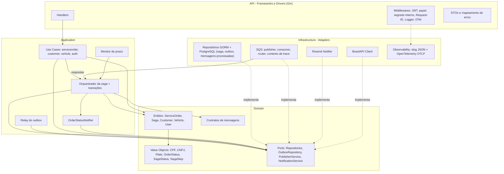
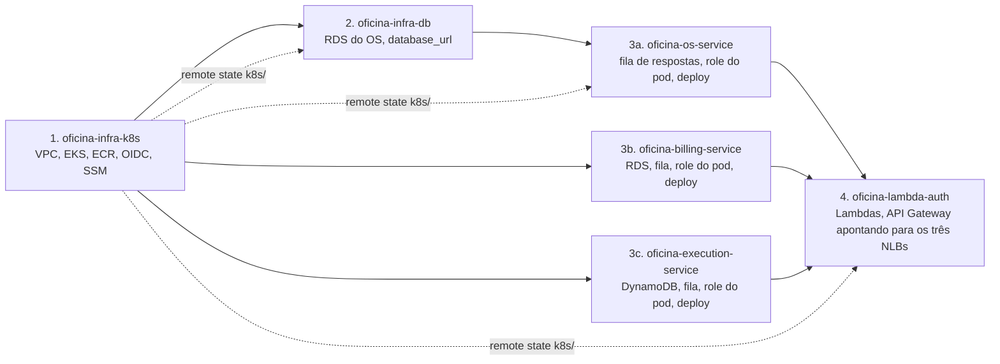

# Diagrama de Componentes

| | |
|---|---|
| **Status** | Vigente |
| **Data** | 2026-11-16 |
| **Autor** | Gabriel Camargo |

Na Fase 4 o monólito foi dividido em três microsserviços. Este documento mostra onde cada um roda, com quem conversa e quem provisiona cada peça.

## 1. Visão de nuvem — microsserviços, filas, bancos, serverless e monitoramento

Setas contínuas são tráfego de requisição ou de mensagem; setas tracejadas são deploy, leitura de configuração ou telemetria.

```mermaid
flowchart TB
    subgraph Users["Usuários e sistemas externos"]
        Customer["Cliente da oficina"]
        Operator["Operador / mecânico"]
        MP["Mercado Pago"]
    end

    subgraph GitHub["GitHub"]
        RepoOS["oficina-os-service"]
        RepoBilling["oficina-billing-service"]
        RepoExecution["oficina-execution-service"]
        RepoK8s["oficina-infra-k8s"]
        RepoDb["oficina-infra-db"]
        RepoLambda["oficina-lambda-auth"]
        Actions["GitHub Actions - OIDC"]
    end

    subgraph AWS["AWS us-east-1"]
        APIGW["API Gateway HTTP API"]
        LambdaAuth["Lambda auth-cpf (fora da VPC)"]
        LambdaAuthz["Lambda authorizer"]
        ECR[("ECR - um repositório por serviço")]
        SSM[("SSM Parameter Store")]
        S3State[("S3 - Terraform state")]

        subgraph SQS["Amazon SQS"]
            QE[["oficina-execution-commands + dlq"]]
            QB[["oficina-billing-commands + dlq"]]
            QR[["oficina-saga-replies + dlq"]]
        end

        DDB[("DynamoDB - Execution<br/>work-orders, catalog, outbox, processed-messages")]

        subgraph VPC["VPC 10.0.0.0/16 - 2 AZs"]
            subgraph PublicSubnets["Subnets públicas"]
                NLBOS["NLB - OS"]
                NLBB["NLB - Billing"]
                NLBE["NLB - Execution"]
                NAT["NAT Gateway"]
            end
            subgraph PrivateSubnets["Subnets privadas"]
                subgraph EKS["EKS 1.34 - node group t3.medium 2..4"]
                    subgraph NsOS["namespace oficina-api"]
                        PodOS["Pods oficina-os-service<br/>HPA 2..6"]
                    end
                    subgraph NsBilling["namespace oficina-billing"]
                        PodBilling["Pods oficina-billing-service<br/>HPA 1..4"]
                    end
                    subgraph NsExecution["namespace oficina-execution"]
                        PodExecution["Pods oficina-execution-service<br/>HPA 1..4"]
                    end
                    NRAgent["New Relic nri-bundle"]
                end
                RDSOS[("RDS PostgreSQL 16 - OS")]
                RDSB[("RDS PostgreSQL 16 - Billing")]
            end
        end
    end

    subgraph NewRelic["New Relic"]
        NRAPM["APM e traces distribuídos"]
        NRLogs["Logs"]
        NRInfra["Infra Kubernetes"]
        NRDash["Dashboards e alertas"]
    end

    Resend["Resend - e-mail"]
    BrasilAPI["BrasilAPI - CNPJ"]

    Customer -->|"POST /auth/cpf"| APIGW
    Customer -->|"/api/v1/budgets com Bearer JWT"| APIGW
    Operator -->|"/api/v1/** com Bearer JWT"| APIGW
    MP -->|"POST /api/v1/webhooks/mercadopago"| APIGW

    APIGW --> LambdaAuth
    APIGW -.->|"valida JWT"| LambdaAuthz
    APIGW -->|"HTTP proxy"| NLBOS
    APIGW -->|"HTTP proxy"| NLBB
    APIGW -->|"HTTP proxy"| NLBE
    NLBOS --> PodOS
    NLBB --> PodBilling
    NLBE --> PodExecution
    LambdaAuth -->|"GET /internal/customers/by-document"| NLBOS

    PodOS -->|"comandos"| QE
    PodOS -->|"comandos"| QB
    QE --> PodExecution
    QB --> PodBilling
    PodExecution -->|"respostas"| QR
    PodBilling -->|"respostas"| QR
    QR --> PodOS

    PodOS --> RDSOS
    PodBilling --> RDSB
    PodExecution --> DDB
    PodBilling -->|"preferência, consulta, estorno"| MP
    PodOS --> Resend
    PodBilling --> Resend
    PodOS --> BrasilAPI

    LambdaAuth -.->|"jwt_secret, internal_api_secret"| SSM
    LambdaAuthz -.->|"jwt_secret"| SSM

    RepoOS --> Actions
    RepoBilling --> Actions
    RepoExecution --> Actions
    RepoK8s --> Actions
    RepoDb --> Actions
    RepoLambda --> Actions
    Actions -.->|"terraform apply"| S3State
    Actions -.->|"build e push"| ECR
    Actions -.->|"kubectl apply -k"| EKS
    Actions -.->|"lê parâmetros"| SSM
    EKS -.->|"pull"| ECR

    PodOS -.->|"OTLP traces"| NRAPM
    PodBilling -.->|"OTLP traces"| NRAPM
    PodExecution -.->|"OTLP traces"| NRAPM
    NRAgent -.->|"logs JSON"| NRLogs
    NRAgent -.->|"CPU e memória"| NRInfra
    NRLogs --> NRDash
    NRAPM --> NRDash
    NRInfra --> NRDash
```

### Componentes e responsáveis

| Componente | Função | Repositório que provisiona |
|---|---|---|
| **API Gateway (HTTP API)** | Porta de entrada única. Uma integração `HTTP_PROXY` por microsserviço; orçamentos e pagamentos vão para o Billing, ordens de trabalho, peças e serviços para o Execution, o restante de `/api/v1` para o OS. Rotas protegidas passam pelo Lambda authorizer. | `oficina-lambda-auth` |
| **Lambda `auth-cpf`** | Valida o CPF, consulta o cliente em `GET /internal/customers/by-document/{document}` do OS Service (cabeçalho `X-Internal-Secret`), exige `status = active` e emite JWT HS256. Roda fora da VPC e não acessa banco. | `oficina-lambda-auth` |
| **Lambda `authorizer`** | Authorizer REQUEST com resposta simples; valida assinatura e expiração do JWT. Cache de 5 min por token. | `oficina-lambda-auth` |
| **NLB (um por serviço)** | Criado pelo `Service` do tipo `LoadBalancer` de cada microsserviço. Descoberto pelo Terraform do gateway pela tag `kubernetes.io/service-name`. | cada serviço (via manifesto) |
| **EKS + node group** | Cluster 1.34 com 2 a 4 nós `t3.medium` (AL2023). Três namespaces de produção: `oficina-api`, `oficina-billing` e `oficina-execution`. Não há ambiente de homologação ([ADR-013](./adr/ADR-013-infraestrutura-por-servico-e-irsa.md)). | `oficina-infra-k8s` |
| **`oficina-os-service`** | Clientes, veículos, ordens de serviço e orquestrador da saga. HPA de 2 a 6 réplicas. | `oficina-os-service` |
| **`oficina-billing-service`** | Orçamento e pagamento pelo Mercado Pago. HPA de 1 a 4 réplicas. | `oficina-billing-service` |
| **`oficina-execution-service`** | Diagnóstico, execução, catálogo e estoque. HPA de 1 a 4 réplicas. | `oficina-execution-service` |
| **SQS `oficina-saga-replies` + DLQ** | Respostas dos participantes, consumidas pelo orquestrador. | `oficina-os-service` (`terraform/`) |
| **SQS `oficina-billing-commands` + DLQ** | Comandos da saga para o Billing. | `oficina-billing-service` (`terraform/`) |
| **SQS `oficina-execution-commands` + DLQ** | Comandos da saga para o Execution. | `oficina-execution-service` (`terraform/`) |
| **RDS PostgreSQL — OS** | `db.t3.micro`, privado, criptografado. Aceita 5432 apenas dos nós do cluster. | `oficina-infra-db` |
| **RDS PostgreSQL — Billing** | Instância própria `oficina-billing-service-db`, `db.t3.micro`, privada. | `oficina-billing-service` (`terraform/`) |
| **DynamoDB — Execution** | Quatro tabelas com cobrança por requisição. | `oficina-execution-service` (`terraform/`) |
| **IAM roles dos pods (IRSA)** | Uma role por serviço, assumida pelo `ServiceAccount` pelo provedor OIDC do cluster, com acesso só às filas e tabelas daquele serviço. | cada serviço (`terraform/`) |
| **ECR** | Um repositório de imagem por microsserviço, com scan no push. | `oficina-infra-k8s` |
| **SSM Parameter Store** | `/oficina-api/jwt_secret` e `/oficina-api/internal_api_secret` (k8s), `/oficina-api/database_url` (db), `/oficina-billing-service/database_url` (billing), `/oficina-api/api_gateway_url` (lambda). | vários |
| **S3 (Terraform state)** | Bucket único com lock nativo; chaves `k8s/`, `db/`, `os/`, `billing/`, `execution/`, `lambda/`. | criado uma vez, fora do Terraform |
| **OIDC + roles do GitHub Actions** | Uma role por repositório, assumida sem chave estática. | `oficina-infra-k8s` |
| **Mercado Pago** | Checkout Pro: preferência de pagamento, consulta, estorno e webhook assinado. | — |
| **New Relic** | Traces via OTLP direto dos três serviços, logs JSON via Fluent Bit, CPU e memória dos pods, dashboards e alertas. | `oficina-infra-k8s` (agentes) |
| **Resend** | E-mail ao cliente em cada mudança de status, no orçamento e no link de pagamento (best-effort). | — |
| **BrasilAPI** | Validação de CNPJ ativo no cadastro de cliente PJ. | — |

## 2. Camadas internas do OS Service — Clean Architecture

As dependências apontam sempre para dentro. Peças, serviços e itens da ordem saíram deste serviço na Fase 4 (foram para o Execution e o Billing); entraram a saga, o orquestrador, o outbox e os adapters de SQS. O Billing e o Execution seguem a mesma divisão de camadas.

| Camada | Pasta | Depende de |
|---|---|---|
| Domain | `internal/domain` | nada externo |
| Application | `internal/application` | apenas do domínio |
| Infrastructure | `internal/infrastructure` | implementa portas do domínio; GORM, AWS SDK, Resend, OTel |
| API | `internal/api` | casos de uso e adapters de observabilidade |

## 3. Fluxo de deploy entre repositórios

A criação segue as dependências dos estados remotos; a destruição é feita na ordem inversa, removendo antes os namespaces para que os NLBs não bloqueiem a VPC.

| Estado remoto | Repositório |
|---|---|
| `k8s/` | `oficina-infra-k8s` |
| `db/` | `oficina-infra-db` |
| `os/` | `oficina-os-service` |
| `billing/` | `oficina-billing-service` |
| `execution/` | `oficina-execution-service` |
| `lambda/` | `oficina-lambda-auth` |

O pipeline de cada microsserviço aplica o Terraform do próprio repositório, publica a imagem e faz o rollout, sem depender do pipeline dos outros. Depois que o gateway é criado, o deploy do Billing é executado de novo para ler `/oficina-api/api_gateway_url`, usado no endereço do webhook do Mercado Pago.
