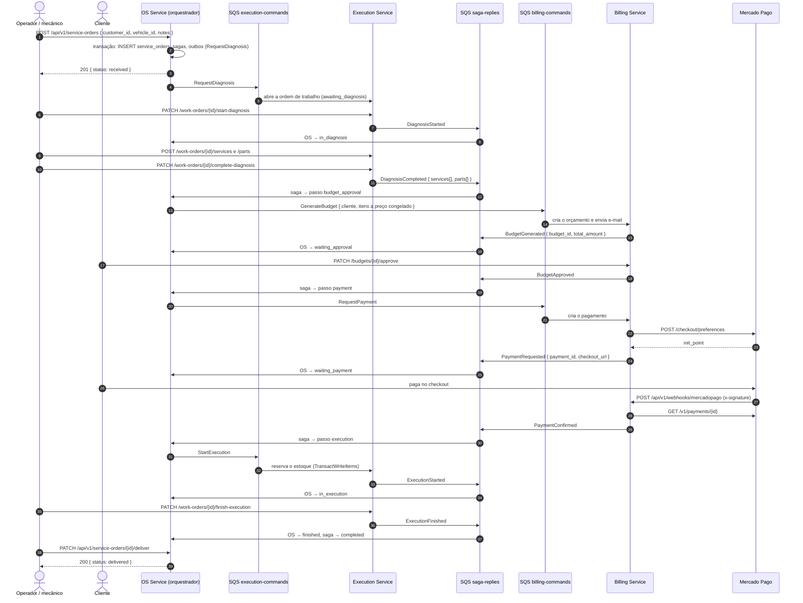
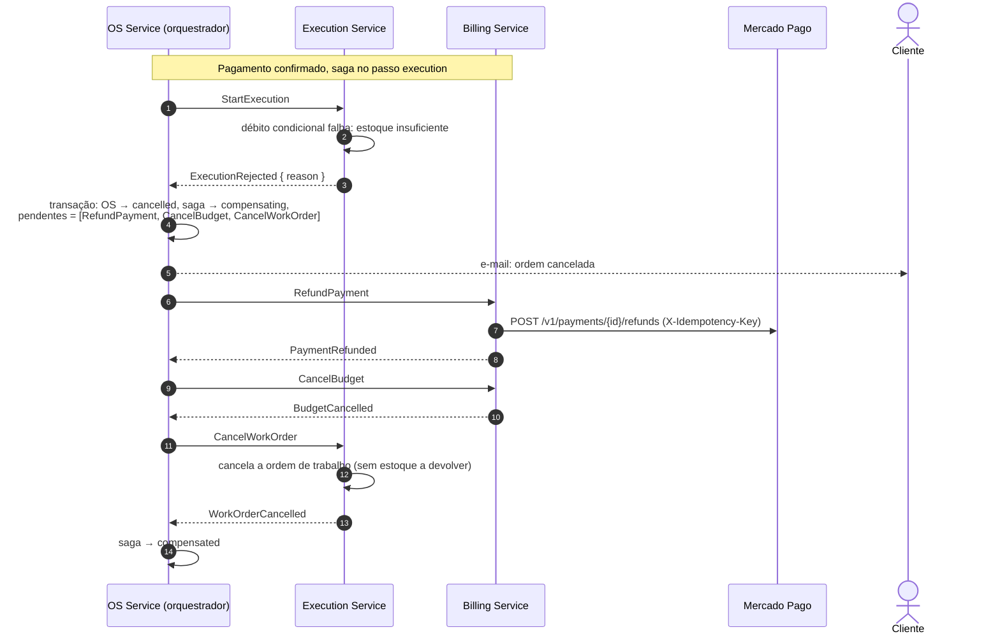
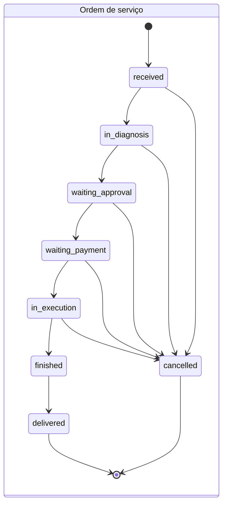
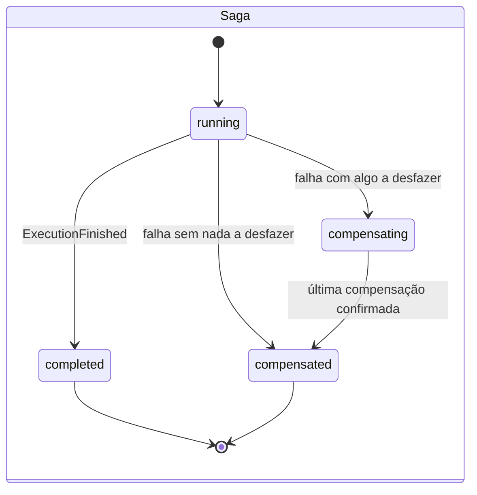
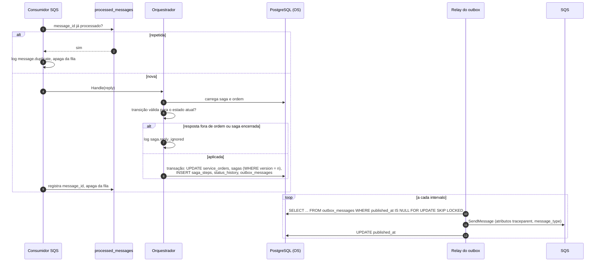

# Diagrama de Sequência — Saga da Ordem de Serviço

| | |
|---|---|
| **Status** | Vigente |
| **Data** | 2026-11-16 |
| **Autor** | Gabriel Camargo |
| **Relacionado** | [messaging-contracts.md](./messaging-contracts.md), [ADR-010](./adr/ADR-010-saga-orquestrada.md), [ADR-011](./adr/ADR-011-outbox-transacional-e-consumo-idempotente.md) |

Desde a Fase 4 a ordem de serviço é conduzida por uma **saga orquestrada**. O OS Service é o orquestrador: envia comandos ao Execution Service e ao Billing Service por filas SQS e reage às respostas. Cada serviço grava no próprio banco; nenhuma transação atravessa serviços.

## 1. Caminho feliz

A cada mudança de status o OS Service envia um e-mail ao cliente (best-effort) e grava uma linha em `service_order_status_history`.

## 2. Compensação — estoque insuficiente depois do pagamento

É o caso com mais passos a desfazer: o orçamento foi aprovado e o pagamento confirmado, mas o Execution Service não consegue reservar as peças. O orquestrador cancela a ordem de serviço e envia as compensações **uma por vez, na ordem inversa**; a próxima só sai depois da confirmação da anterior.

### Compensações por tipo de falha

| Falha | Vem de | Compensações, em ordem |
|---|---|---|
| `DiagnosisFailed` | Execution | nenhuma |
| `BudgetRejected` | Billing | `CancelWorkOrder` |
| `PaymentFailed` | Billing | `CancelBudget` → `CancelWorkOrder` |
| `ExecutionRejected` | Execution | `RefundPayment` → `CancelBudget` → `CancelWorkOrder` |
| Cancelamento pelo operador (`PATCH /service-orders/{id}/cancel`) ou prazo esgotado | OS | passo `diagnosis`: `CancelWorkOrder`; passo `budget_approval`: `CancelBudget` → `CancelWorkOrder`; passos `payment` e `execution`: `RefundPayment` → `CancelBudget` → `CancelWorkOrder` |

Os comandos de compensação são idempotentes e toleram ausência do recurso: `RefundPayment` sem pagamento confirmado, `CancelBudget` sem orçamento e `CancelWorkOrder` sem ordem de trabalho apenas respondem a confirmação.

## 3. Estados

Passos da saga enquanto está `running`: `diagnosis` → `budget_approval` → `payment` → `execution`. O status da ordem só avança: uma resposta atrasada de um passo anterior não faz a ordem voltar.

## 4. Como as garantias entram no fluxo

| Garantia | Mecanismo |
|---|---|
| Nenhum comando perdido | Outbox transacional: a mensagem é gravada com a mudança de estado e publicada depois pelo relay |
| Sem efeito duplicado | `processed_messages` no consumidor e verificação de estado nos casos de uso |
| Sem duas réplicas aplicando a mesma resposta | Controle otimista: `UPDATE sagas ... WHERE version = n`; em conflito a mensagem volta à fila |
| Saga parada não fica presa | `deadline` por passo (`SAGA_STEP_TIMEOUT`, padrão 72 h); o monitor cancela e compensa as vencidas |
| Mensagem que sempre falha | Depois de 5 entregas vai para a fila `-dlq` |
| Um trace para o fluxo todo | O contexto W3C é guardado no outbox e viaja nos atributos da mensagem |

## 5. NRQL de referência

| Pergunta | Consulta |
|---|---|
| Volume diário de ordens abertas | `SELECT count(*) FROM Log WHERE event = 'saga.started' TIMESERIES 1 day` |
| Tempo médio em cada status | `SELECT average(numeric(duration_minutes)) FROM Log WHERE event = 'service_order.status_changed' FACET from_status` |
| Sagas concluídas x compensadas | `SELECT count(*) FROM Log WHERE event IN ('saga.completed', 'saga.compensated') FACET event TIMESERIES` |
| Motivos de compensação | `SELECT count(*) FROM Log WHERE event = 'saga.compensating' FACET failure_reason` |
| Avanço da saga por resposta recebida | `SELECT count(*) FROM Log WHERE event = 'saga.step_completed' FACET reply TIMESERIES` |
| Respostas repetidas ou atrasadas | `SELECT count(*) FROM Log WHERE event IN ('saga.reply_ignored', 'message.duplicate') FACET event` |
| Mensagens processadas por serviço | `SELECT count(*) FROM Log WHERE event = 'message.processed' FACET service.name, message_type` |
| Falhas de processamento (alerta) | `SELECT count(*) FROM Log WHERE event = 'message.failed' FACET service.name` |
| Sagas canceladas por prazo (alerta) | `SELECT sum(sagas) FROM Log WHERE event = 'saga.timed_out'` |
| Latência por rota e por serviço | `SELECT percentile(duration.ms, 50, 95) FROM Span WHERE service.name LIKE 'oficina-%' FACET service.name, http.route` |
| Um fluxo de ponta a ponta | `SELECT * FROM Log WHERE order_id = '<id>' SINCE 1 day ago` ou o trace distribuído aberto a partir de qualquer linha |

Todas as linhas levam `request_id`, `trace_id` e `span_id`; as da saga levam `saga_id` e `order_id` (ver [ADR-006](./adr/ADR-006-logs-estruturados-com-correlacao.md)).
